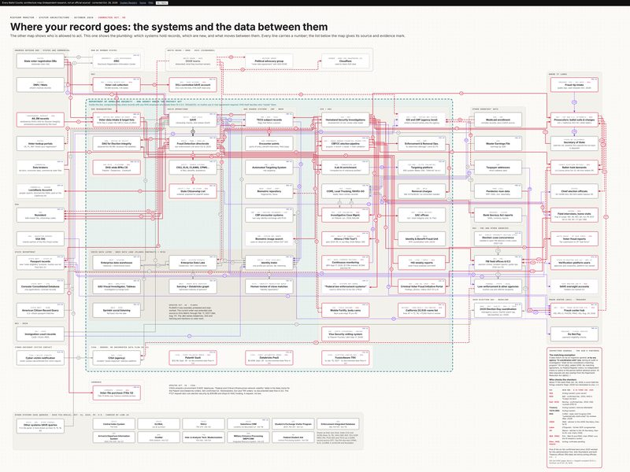

Every other election-eve case was about the *letters*. Judge Tanya Chutkan's ruling in *League of Women Voters v. DHS* goes after the *pipeline* behind them, and it does it with the dullest weapon in the federal toolbox: paperwork.

## What she ordered

No more "disclosing, transmitting, or releasing data purporting to constitute lists of individual potential or actual non-citizen voters or registered voters" to any state or local official who registers voters, handles ballots or counts votes. DOJ also has 24 hours to name the "senior official" responsible for actually complying. Names, not vibes. ([order](https://www.courtlistener.com/?q=%22League+of+Women+Voters%22+%2226-cv-03602%22) · [opinion](https://storage.courtlistener.com/recap/gov.uscourts.dcd.297656/gov.uscourts.dcd.297656.31.0.pdf)) D

## The receipts, in order

**The law (Privacy Act, 1974):**

> An agency that maintains a system of records shall "publish in the Federal Register upon establishment or revision a notice of the existence and character of the system of records."
> <small>5 U.S.C. 552a(e)(4)</small>

**What the government's own papers say it built:**

> USCIS's 2025 privacy assessment for its citizenship-check system says bulk checks by Social Security number "may include those of U.S. born citizens." D
>
> A DHS official swore that California's list was built by running the state's voter roll through LexisNexis Accurint, a commercial people-search database, outside that system. D
>
> The list DOJ sent Washington covers people who "are or were noncitizens (i.e., they may have subsequently naturalized)." D

**What the judge said:**

> The government "collected millions of voting records—including those of U.S. citizens."
>
> It is "flatly inconsistent with the text, structure, and purpose of the Privacy Act for an agency to initiate a major new data-sharing program affecting the sensitive data of millions of Americans" without publishing that notice. (quoting another judge in the same courthouse)
>
> On the "it's for law enforcement" exception: "Defendants have not identified any such request."

It kind of speaks for itself.

## "It's for law enforcement" isn't a magic phrase

The Privacy Act does have a law-enforcement exception. It's a real exception, and it exists for a good reason. But it covers specific records, requested in writing, case by case. It doesn't cover tens of millions of voter records sent out in bulk because someone said "law enforcement" out loud. That phrase keeps turning up as the excuse this year. I'm tracking it on the [phrase trail](/phrase-trail/).

## What the plaintiffs say is behind it

The plaintiffs allege, and the court recounts without deciding, "an unauthorized project to amass a national database of voter registration information" built from "at least 47 states." D

***Wish you could see what that looks like?*** *She called their bluff in court. I mapped it online, tied to the privacy filings (you know, the ones the government did file).*

[The map](/map/architecture.html) · [the registry](/registry/) · [a one-minute short on the California list's route](https://www.youtube.com/shorts/Y8tx7PmbMCU)

## The fine print

SAVE checks a state requests and actual prosecutions can continue. It's preliminary, DOJ can appeal, and the easy fix on DOJ's side is to finally publish the notice. So watch the Federal Register.

But today: no more lists. Go vote.

— Amanda
