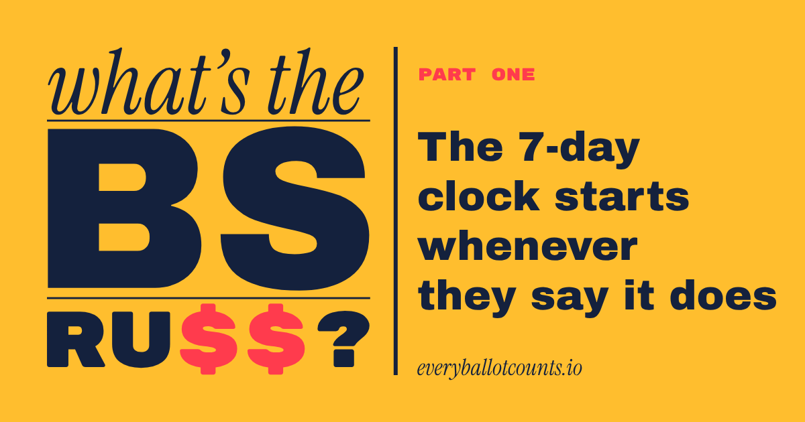

*Part one of our "What's the big surprise, Russ?" series. This one is the groundwork: the law, plus the pieces the government already put in place. Part two gets into how they could be used.*

I write contracts for a living, and there's one fight I have in basically every data deal: when does a breach "happen"?

The company holding the data wants the notice clock to start when it **confirms** a breach. The customer wants it to start when the company **suspects** one (or should have known). Same incident, different words ... and whoever wins that sentence controls the timeline. Totally normal lawyering.

So imagine my face when I found the same sentence in federal cyber law, written both ways at once. The government gets to **act** on a suspicion. It only has to **tell Congress** once it "concludes." Here's how that works, in order.

## The receipts

**1. The emergency directive.** The Federal Information Security Modernization Act (FISMA) gives the DHS Secretary this power:

> "in response to a known or reasonably suspected information security threat, vulnerability, or incident that represents a substantial threat to the information security of an agency, the Secretary may issue an emergency directive to the head of an agency to take any lawful action with respect to the operation of the information system, including such systems used or operated by another entity on behalf of an agency."

That's [44 U.S.C. 3553(h)](https://www.govinfo.gov/content/pkg/USCODE-2023-title44/html/USCODE-2023-title44-chap35-subchapII.htm). D Read it again slowly: "reasonably suspected" ... "any lawful action" ... "systems used or operated by another entity," aka contractors. Like, say, the Palantir and Databricks platforms CISA bought in September ([USAspending](https://www.usaspending.gov/award/CONT_AWD_70RCSJ26FC0000028_7001_70RTAC26A00000001_7001)). One signature from the DHS Secretary gets you there, and today that's Markwayne Mullin.

**2. The "major incident."** FISMA has the White House budget office (OMB) define what counts as a "major incident." The definition in force is OMB's [M-25-04](https://bidenwhitehouse.archives.gov/wp-content/uploads/2025/01/M-25-04-Fiscal-Year-2025-Guidance-on-Federal-Information-Security-and-Privacy-Management-Requirements.pdf) (Jan. 15, 2025; no replacement yet): an incident "likely to result in demonstrable harm to the national security interests, foreign relations, or the economy of the United States, or to the public confidence, civil liberties, or public health and safety of the American people." D

Then, for big breaches, it takes the judgment call off the table entirely: "This memorandum requires a determination of major incident for any unauthorized modification of, unauthorized deletion of, unauthorized exfiltration of, or unauthorized access to the PII of 100,000 or more people." D And agencies "must report to CISA and the OMB OFCIO within 1 hour of determining a major incident occurred." D

One hour. Hold onto that, because the next part is where it gets interesting.

**3. The domino.** Same memo: "if a cyber incident is a major incident, it is also a 'significant cyber incident.' Thus, a major incident as defined above will also trigger the coordination mechanisms outlined in PPD-41." D [PPD-41](https://obamawhitehouse.archives.gov/the-press-office/2016/07/26/presidential-policy-directive-united-states-cyber-incident) is the 2016 presidential directive that puts the FBI in charge of the threat-response side of a big cyber incident. D And no, it's not gathering dust. ATF declared a "major incident" in August, the day after a ransomware gang claimed it had hacked the agency ([Nextgov](https://www.nextgov.com/cybersecurity/2026/08/atf-investigating-major-cyber-incident-after-ransomware-group-claim/415668/), [TechCrunch](https://techcrunch.com/2026/08/27/atf-declares-major-incident-as-ransomware-gang-claims-hack/)). R

**4. The clock.** Congress hears about it last. An agency has to notify the relevant committees "no later than seven days after the date on which the agency determines that it has a reasonable basis to conclude that a major incident ... has occurred" (M-25-04, implementing [44 U.S.C. 3554](https://www.govinfo.gov/content/pkg/USCODE-2023-title44/html/USCODE-2023-title44-chap35-subchapII.htm)). D

So, recap: act on "reasonably suspected." Tell CISA within an hour. Tell Congress within seven days of deciding you're sure. The seven days don't start when something happens - they start when the agency says it has concluded something happened. (And a committee getting a notice is not the same thing as *you* getting a notice.)

**5. And national security?** OMB's memo and these DHS powers "do[] not apply to national security systems." D You'd think that's a limit. It's really a second track: national security systems run through the Pentagon and the intelligence agencies, so a system that gets called both gets both tracks running at once. Guess whose track is already pointed at elections (hint: see Sept. 22 below). I

## None of this is new (that's kind of the point)

Look at the dates: FISMA is from 2014. PPD-41 is from 2016. Election systems became "critical infrastructure" in 2017, which is the hook Trump's 2025 elections order hangs DHS's whole role on ([EO 14248](https://www.federalregister.gov/documents/2025/03/28/2025-05523/preserving-and-protecting-the-integrity-of-american-elections), sec. 6(a)). The foreign-interference emergency is from 2018, and the "significant incident" law is from 2021. Every one of them was written for real attacks by real foreign hackers. D

That's the pattern with this administration. They don't go to Congress and stand something up properly, with its own rules and its own oversight ... they grab a law/agency/database/contract that already exists and point it somewhere new. SAVE was built to check whether immigrants qualify for benefits, and now states run entire voter rolls through it ([NPR](https://www.npr.org/2025/09/10/nx-s1-5477367/save-election-citizenship-data-trump)). R Hegseth's memo sends Cyber Command into elections using "existing authorities, capabilities, and competencies." D No new law means no new debate, and no new debate means no new limits. I

Which brings us to the part I can't stop staring at.

## Sound familiar?

That harm list (national security, foreign relations, the economy, "public confidence," public health and safety)? It's word for word the list in the law that lets the DHS Secretary declare a "significant incident" ([6 U.S.C. 677a](https://www.law.cornell.edu/uscode/text/6/677a), row 3 on [our board](/tripwires/)), which covers "an incident or a group of related incidents." D And "public confidence" is the same phrase that defines the national emergency over foreign election interference, renewed every year since 2018 ([our phrase trail](/phrase-trail/)). D

In other words, one set of facts can open three doors: a major incident, a significant cyber incident and a "significant incident." Same claim, three badges. I

So what facts are already sitting on the record? Here's the setup, pleading-style ... not every fact, just enough to state the claim (sources are in the notes at the end):

- **Jul. 26, 2016:** FBI in charge of threat response for any "significant cyber incident," with the Pentagon supporting "as needed."[^ppd41] D
- **Nov. 15, 2021:** Congress lets the DHS Secretary declare a "significant incident."[^677] D
- **July 2026:** DHS-CISA guide for state election officials opens: "Recently declassified records revealed that China breached multiple state voter registration systems prior to the 2020 election."[^vrdb] D
- **Jul. 17, 2026:** The White House says China "compromised U.S. voter data on a massive scale" and "obtained the personal data of 220 million American voters."[^wh] D
- **Aug. 24, 2026:** Mullin writes the White House that China-made parts in voting machines could allow "synchronized attacks across multiple machines and jurisdictions."[^mullin] D Same day, DOJ launches a National Fraud Detection Center with HSI, the FBI, a dozen inspectors general and seven secretaries of state.[^nfdc] D
- **Sept. 22, 2026:** Hegseth orders Cyber Command, NSA, DIA and NGA to "mobilize every authorized asset" for elections, "a no-fail mission."[^hegseth] D
- **Sept. 24, 2026:** DHS quotes Mullin: "Election security is national security."[^eisp] D
- **Oct. 29, 2026:** DOJ tells election officials in all 50 states to preserve records for 22 months, ballots included.[^preserve] R
- **Nov. 3, 2026:** Mullin on Election Day: "we'll be gathering the voting logs."[^logs] R
- **Nov. 9, 2026:** CISA rolls out an incident form built to "identify a larger trend from what otherwise would appear as independent incidents."[^form] D

## So what's the tell?

Everyone's waiting for a notice. But the hard part of a breach notice is the claim, and the government already made it, in writing, on federal letterhead: China "breached multiple state voter registration systems." China "compromised U.S. voter data on a massive scale." 220 million voters. D

That's the China cyber report, and that's the suspicion. Under FISMA, a suspicion is all you need to act.

Now put it next to what the government holds today. DHS and DOJ "have collected millions of voting records," per a federal judge ([Chutkan opinion](https://storage.courtlistener.com/recap/gov.uscourts.dcd.297656/gov.uscourts.dcd.297656.31.0.pdf)). D Whole state rolls have been run through SAVE. R All of it is way past 100,000 people.

So the last step is one sentence: that the 2020 breach reached the voter data the government holds now. Accessed, altered, tainted ... pick your verb. Under the government's own memo, that's an automatic major incident, automatically a significant cyber incident, and the FBI is in charge of the evidence. Point the same claim at the machines and it's a "significant incident" too. Call the system a national security system and the Pentagon's lane opens right alongside it. I

And we wouldn't know the clock was running. The seven-day notice goes to committees. The yearly FISMA reviews go to OMB, and nothing requires them to be made public. D

Two more things worth knowing before part two:

- **Who writes the definition.** "Major incident" is defined by an OMB memo, not by Congress. OMB is Russ Vought's office (hi, Russ), and the memo in force is a Biden-era one his office hasn't replaced yet. A memo can be rewritten without a vote, and OMB is already using them to rewire federal systems: in August it made Login.gov the "universal sign-on" for public services ([M-26-18](https://www.whitehouse.gov/wp-content/uploads/2026/08/M-26-18-Scaling-Use-of-Login.gov-to-Deliver-a-Universal-Sign-on-for-Public-Services.pdf)). D
- **The next date on the calendar.** The 2018 emergency order gives the Director of National Intelligence until 45 days after the election to assess foreign interference. That's Dec. 18. D Mark it.

## Coming next: Fruit of the Poisonous Treason

Per usual, I'm starting with the receipts. Next up is a deep dive into a hypothetical I see teed up like the president 30 minutes into the average "work" day.

Before he was Attorney General, Todd Blanche was Donald Trump's criminal defense lawyer ([AP via WTOP](https://wtop.com/national/2026/04/a-look-at-todd-blanche-the-ex-trump-lawyer-whos-the-presidents-pick-for-acting-attorney-general/)). R Defense lawyers know the fastest way to win isn't always to prove the other side wrong. Sometimes you just get the evidence thrown out. Sometimes you twist words. He's the "reasonable doubt" guy, not the "law and order" guy. At his own confirmation hearing in July, asked about Trump, he said "I'm his lawyer" before correcting himself to "was" ([PBS](https://www.pbs.org/newshour/politics/watch-im-his-lawyer-blanche-says-of-his-relationship-to-trump-before-correcting-himself)). R And this week, on Fox & Friends, he said his job is "to defend the administration," while warning the incoming Democratic lawmakers that "you cannot threaten" ([The New Republic](https://newrepublic.com/post/217838/todd-blanche-threatens-arrest-democrats)). R So he's decided the AG defends the administration instead of the people (spoiler alert: it doesn't). I

So what happens if the data the states handed over turns out to be tainted? Not stolen. Tainted. Everything that touched it becomes fruit of the poisonous tree…ason.

The tell is out. Anyone know if Secretary Mullin and the newly anointed incoming minority leaders are getting lunch this week?

— Amanda

*Fine print: D is a document, R is reporting, I is my inference. The statute, memo and government quotes are exact.*

[^ppd41]: Presidential Policy Directive 41, "United States Cyber Incident Coordination," July 26, 2016. [White House archive](https://obamawhitehouse.archives.gov/the-press-office/2016/07/26/presidential-policy-directive-united-states-cyber-incident)
[^677]: Cyber Response and Recovery Act, 6 U.S.C. 677-677g (2021). [6 U.S.C. 677a](https://www.law.cornell.edu/uscode/text/6/677a)
[^vrdb]: DHS and CISA, "Recognizing and Addressing Threats to Statewide Voter Registration Databases," July 2026, p. 1. [CISA](https://www.cisa.gov/sites/default/files/2026-09/Voter-Registration-Database-Threats-FINAL.pdf)
[^wh]: White House, "Setting the Record Straight: President Trump Declassifies Intel on Foreign Election Interference and Deep State Coverup," July 17, 2026. [White House](https://www.whitehouse.gov/releases/2026/07/setting-the-record-straight-president-trump-declassifies-intel-on-foreign-election-interference-deep-state-coverup/)
[^mullin]: Letter, DHS Secretary Mullin to the White House Transparency Task Force, Aug. 24, 2026, pp. 1-2, in the DHS Election Integrity Memoranda release. [White House file](https://www.whitehouse.gov/wp-content/uploads/2026/08/DHS-Election-Integrity-Memoranda.zip)
[^nfdc]: DOJ, "Justice Department announces launch of National Fraud Detection Center," Aug. 24, 2026. [DOJ](https://www.justice.gov/opa/pr/department-justice-announces-launch-national-fraud-detection-center-combat-fraud-against)
[^hegseth]: Secretary of War Hegseth, "Countering Foreign Threats to 2026 Elections," signed Sept. 22, 2026, released Sept. 28. [Defense Dept.](https://media.defense.gov/2026/Sep/28/2004007844/-1/-1/1/COUNTERING-FOREIGN-THREATS-TO-2026-ELECTIONS.PDF)
[^eisp]: DHS release on CISA's "2026 Election Infrastructure Security Plan," Sept. 24, 2026. [The plan (CISA)](https://www.cisa.gov/sites/default/files/2026-09/2026-CISA-Election-Security-Plan-FINAL-508c.pdf)
[^preserve]: Democracy Docket, Oct. 2026. [Democracy Docket](https://www.democracydocket.com/news-alerts/doj-warns-election-officials-in-all-50-states-of-criminal-penalties-days-before-midterms/)
[^logs]: Democracy Docket, Nov. 3, 2026. [Democracy Docket](https://www.democracydocket.com/news-alerts/mullin-says-trump-admin-will-comb-voting-logs-to-hunt-for-noncitizens-after-election/)
[^form]: CISA, "CISA Announces Enhanced Reporting Form for Cyber Incidents," Nov. 9, 2026. [CISA](https://www.cisa.gov/news-events/news/cisa-announces-enhanced-reporting-form-cyber-incidents)
